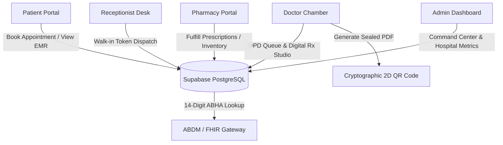

# MedVault — Next-Gen Smart Healthcare SaaS Platform 🏥

[](https://react.dev/)
[](https://www.typescriptlang.org/)
[](https://vitejs.dev/)
[](https://tailwindcss.com/)
[](https://supabase.com/)
[](https://abdm.gov.in/)
[](LICENSE)

> **Unified Electronic Medical Records (EMR), Real-Time Multi-Portal Clinical Operations, OPD Queue Management, and ABDM/FHIR Interoperability.**

---

## 📄 Research Paper & Publications

MedVault includes a publication-grade, 4-page IEEE research paper authored for academic review and clinical systems benchmarking:

- 📄 **Research Paper (PDF):** [`docs/MedVault_Research_Paper.pdf`](docs/MedVault_Research_Paper.pdf)
- 📝 **Editable Word Document (DOCX):** [`docs/MedVault_Research_Paper.docx`](docs/MedVault_Research_Paper.docx)
- 📖 **Full Paper (Markdown):** [`docs/MedVault_Research_Paper.md`](docs/MedVault_Research_Paper.md)
- 🖋️ **LaTeX Source (Overleaf Ready):** [`docs/MedVault_Research_Paper.tex`](docs/MedVault_Research_Paper.tex)

**Paper Title:**  
*MedVault: An ABDM-Compliant Interoperable Digital Health Ecosystem with Cryptographic Consent, Dynamic MEWS Triage, and Decentralized Records Verification*  
*(Silver Oak University, Department of Computer Engineering / IT, Project ID: CSE_M2_41)*

---

## 📌 Overview

**MedVault** is an enterprise-grade digital healthcare management and Electronic Medical Records (EMR) ecosystem engineered to solve the operational bottlenecks of outpatient departments (OPD), fragmented patient records, handwriting illegibility in prescriptions, and lack of government health data interoperability.

The platform provides dedicated, synchronized portals for **Patients**, **Doctors**, **Receptionists**, **Pharmacies**, and **Hospital Administrators**, uniting clinical workflows into a single reactive application.



---

## 🌟 Key Portals & Capabilities

### 🩺 1. Doctor Clinical Chamber
- **Live OPD Queue**: View active waiting patients organized sequentially with priority triage.
- **Dual-Channel Dossier Inspection**: Direct one-click access to both federated ABDM/ABHA records and patient-uploaded offline paper records/PDFs.
- **Completed Consultations Archive**: Full history of examined patients with diagnostic logs.
- **Digital Prescription (Rx) Studio**: Formulate structured medications with dosage cadence (1-0-1), duration, dietary advisories, and lab test recommendations.
- **Emergency MEWS Triage Alerts**: Real-time visual interrupt cues when a patient's vitals deteriorate past critical thresholds.

### 🏨 2. Receptionist Desk
- **Walk-in Patient Registration**: Rapid intake capturing patient demographics and symptoms in under 30 seconds.
- **Deterministic Token Dispatch**: Automatic sequential token numbering (#1, #2, #3) auto-routed to attending physicians.
- **Doctor Filter Tabs**: Real-time visibility into queue depth across all hospital departments.

### 👤 3. Patient Personal Health Vault
- **Digital ABHA Card**: 14-digit government Ayushman Bharat Health Account card with verification QR.
- **Self-Governed Fallback Records Vault**: Upload scanned physical prescriptions, lab photos, and radiology reports (scoped securely to patient profile).
- **Vitals Telemetry Tracker**: Log Blood Pressure, SpO2, Pulse Rate, and Blood Glucose with WHO risk badges.
- **Interactive Appointment Booking**: Multi-step calendar booking modal with automated confirmation slips.
- **Prescription Locker**: Download digitally stamped, cryptographic A4 PDF prescriptions.
- **Cashless Health Insurance Pre-Auth**: Attach diagnostic evidence and pre-authorize claims directly in-portal.

### 💊 4. Pharmacy & Telehealth Hub
- **Prescription Dispensing**: Real-time verification of doctor-signed prescriptions via 2D QR barcode scanner.
- **Medicine Inventory Catalog**: Search, filter, and dispense pharmaceuticals with automated stock sync.
- **Teleconsultation Links**: Virtual WebRTC video consultation integration for remote patient care.

### 📊 5. Hospital Administrator Command Center
- **Operational Analytics**: Real-time metrics on patient throughput, daily consultations, and department utilization.
- **Staff Onboarding & Access Control**: Manage physician credentials and department assignments.
- **Compliance & Audit Logging**: Immutable cryptographic logs for DPDP Act and HIPAA auditing.

---

## 🏛️ Regulatory & Standards Compliance

- **ABDM (Ayushman Bharat Digital Mission)**: Pre-architected sandbox integration for 14-digit ABHA ID resolution.
- **FHIR v4.0.1 (Fast Healthcare Interoperability Resources)**: Standardized EMR clinical bundle schemas.
- **Cryptographic Prescription Sealing**: SHA-256 tamper-evident verification via embedded 2D QR barcodes.
- **DPDP Act 2023 & HIPAA Security Rules**: Strict role-based access control and patient data sovereignty.
- **Database Security**: Enforced PostgreSQL Row Level Security (RLS) policies ensuring cross-tenant privacy.

---

## 💻 Tech Stack

| Layer | Technologies |
| :--- | :--- |
| **Frontend** | React 18, TypeScript, Tailwind CSS, Lucide React |
| **Build System** | Vite 5 |
| **State Management** | Zustand (Persistent Reactive In-Memory Stores) |
| **Database & Auth** | Supabase (PostgreSQL 16, Row Level Security, Auth) |
| **Document Synthesis** | jsPDF, html2canvas (Tamper-proof A4 PDF Generation) |
| **Barcode Engine** | QRCode Matrix Generator |
| **Communication** | WebRTC Peer-to-Peer Signaling & SRTP Encryption |

---

## 🚀 Getting Started

### Prerequisites
- **Node.js** (v18.0 or higher)
- **npm** or **yarn**

### Quick Installation

```bash
# 1. Clone the repository
git clone https://github.com/mohitchaudhary-art/medvault.git

# 2. Navigate to project root
cd medvault

# 3. Install dependencies
npm install

# 4. Configure environment variables (Optional for demo mode)
cp .env.example .env

# 5. Start development server
npm run dev
```

Visit `http://localhost:5173` to access the application.

---

## 📁 Repository Structure

```text
medvault/
├── public/                 # Static assets, SVG icons, and favicons
├── src/
│   ├── assets/             # Brand logos and vector graphics
│   ├── components/         # Modular React UI components
│   │   ├── auth/           # Login modal and route guards
│   │   ├── common/         # Navbar, footer, role switcher
│   │   ├── landing/        # Hero, search, feature showcases
│   │   ├── patient/        # Appointment booking modals
│   │   └── pharmacy/       # Cart drawer and order cards
│   ├── data/               # Verified clinical mock datasets
│   ├── lib/                # Supabase client configuration
│   ├── pages/              # Portal views (Doctor, Patient, Admin, Receptionist, Pharmacy)
│   ├── services/           # PDF synthesis and QR code engines
│   ├── store/              # Zustand persistent state machines
│   └── types/              # Comprehensive TypeScript interfaces
├── supabase/               # SQL schema definitions & RLS security migrations
├── docs/                   # Research Paper (PDF, DOCX, MD, TeX) & academic slides
├── generate_perfect_paper.py # Master IEEE paper generation script
├── .env.example            # Environment variable template
├── package.json            # Dependencies and build scripts
└── README.md               # Project documentation
```

---

## 🎓 Academic Project Information

- **Project Title:** MedVault: An ABDM-Compliant Interoperable Digital Health Ecosystem
- **Project ID:** `CSE_M2_41`
- **Institution:** Silver Oak University (Silver Oak College of Engineering & Technology)
- **Team Members:**
  - **Mohit Chaudhary (Mohit Kumar)** — Lead Full Stack & Architecture
  - **Hemant Mali** — Backend & Database Systems
  - **Rahul Mali** — UI/UX & Clinical Workflows

---

## 📄 License
This project is open-source and licensed under the [MIT License](LICENSE).
