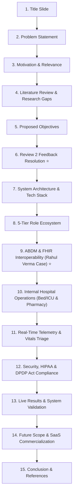
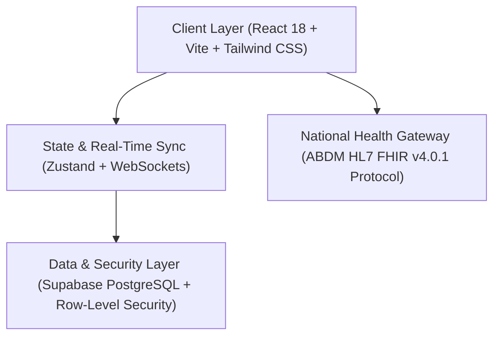

# 🏥 MedVault: Final Review Master Presentation Deck & Script

> **Project Title**: MedVault - Smart Digital Health Record and Hospital Management System  
> **Course / Subject**: B.Tech Final Project (Computer Science & Engineering) | Code: `1010103494`  
> **Project ID**: `CSE_M2_41`  
> **Project Guide**: Dr. Monali Suthar  
> **Team Members**:  
> 1. **Mohit Kumar** (Team Lead)  
> 2. **Hemant Mali**  
> 3. **Rahul Mali**  
> **Target Event**: Final Project Review & Viva Evaluation (Saturday Demo)

---

## 📑 Slide Outline & Presentation Flow (15 Slides)

---

## 📽️ Slide 1: Title & Team Introduction

### 📌 On-Slide Content (PowerPoint me ye likhein):
- **Project Title**: **MedVault: Smart Digital Health Record & Hospital Management System**
- **Domain**: Health-Tech • B2B Healthcare SaaS • Government ABDM Interoperability
- **Under the Guidance of**: **Dr. Monali Suthar**
- **Presented by**:
  - **Mohit Kumar** (Project Lead / Architecture & Full Stack)
  - **Hemant Mali** (Database & Security / ABDM FHIR Integration)
  - **Rahul Mali** (UI/UX Engineering & Telemedicine)
- **Institution**: Department of Computer Science & Engineering

### 🗣️ Spoken Script (English):
> *"A very pleasant morning to our respected project guide, Dr. Monali Suthar Ma'am, and honorable panel members.  
> My name is **Mohit Kumar**, and together with my teammates **Hemant Mali** and **Rahul Mali**, we are proud to present our final engineering project: **'MedVault: Smart Digital Health Record and Hospital Management System'** under Project ID `CSE_M2_41`."*

### 💡 Hindi Meaning & Tip:
*Poore confidence se start karein. Teeno team members ka naam aur guide Ma'am ka naam clear bolna hai.*

---

## 📽️ Slide 2: Problem Statement

### 📌 On-Slide Content:
- **Paper-Based Prescription Loss**: Over 40% of physical prescriptions are lost, damaged, or illegible, causing dangerous medication errors.
- **Inter-Hospital Data Silos**: Patient records in Hospital A (e.g. Apollo) are inaccessible to Hospital B (e.g. Fortis), forcing repetitive diagnostic tests.
- **Uncoordinated OPD Waiting Times**: Manual paper registers cause 45–90 minute delays between the front desk reception and doctor consultation cabins.
- **Fragmented Health Management**: Patients lack a unified digital vault for telemetry tracking (BP, SpO2, glucose) and verified prescriptions.

### 🗣️ Spoken Script (English):
> *"In modern healthcare delivery, traditional hospital workflows suffer from severe data fragmentation.  
> Patients carry physical paper folders from clinic to clinic, which are frequently misplaced or damaged.  
> Furthermore, diagnostic data remains trapped in isolated hospital silos—forcing patients to undergo redundant lab tests and exposing them to dangerous drug interactions because doctors lack their historical medical context.  
> Our primary challenge was: How can we connect hospital staff, patients, and national health registries into one cohesive, zero-delay ecosystem?"*

---

## 📽️ Slide 3: Motivation & Relevance

### 📌 On-Slide Content:
- **National Digital Health Push**: Alignment with Government of India's **Ayushman Bharat Digital Mission (ABDM)** and **14-digit ABHA Health Accounts**.
- **Digital Personal Data Protection (DPDP) Act 2023**: Transitioning patient health records into legally protected, consent-driven digital assets.
- **Enterprise SaaS Scalability**: Replacing expensive, legacy on-premise desktop HIS software with a modern, cloud-native web platform.
- **Patient-Centric Care**: Providing citizens instant access to verified A4 prescriptions, appointment passes, and live vital trends from home.

### 🗣️ Spoken Script (English):
> *"Our core motivation is aligned with the National Health Authority's mandate for universal health digitalization under the Ayushman Bharat Digital Mission (ABDM).  
> Under India's Digital Personal Data Protection Act of 2023, patient medical records are sovereign assets owned by the citizen, not the private hospital.  
> MedVault bridges this gap by offering a cloud-native B2B SaaS platform that enables hospitals to achieve full ABDM compliance, eliminate paper registers, and provide patients with an encrypted health vault."*

---

## 📽️ Slide 4: Literature Review & Research Gaps

### 📌 On-Slide Content:

| Platform Category | Existing Limitations | MedVault Novelty |
| :--- | :--- | :--- |
| **Aggregator Apps** *(Practo, Apollo 24/7)* | Closed commercial booking; lacks hospital reception queue sync and inpatient bed ERP. | **End-to-End Hospital ERP + Public Directory** |
| **Legacy HIS Systems** *(CDAC, Wipro HIS)* | Heavy on-premise software; zero patient-facing health locker or mobile vitals charts. | **Cloud Web Platform with Patient Vault** |
| **Government Portals** *(CoWIN, ABHA App)* | Basic ID generator; lacks live doctor prescription writing and clinical triage. | **Full Clinical Rx Studio + FHIR v4.0.1 Gateway** |

### 🗣️ Spoken Script (English):
> *"During our literature survey, we analyzed commercial healthcare aggregators like Practo, proprietary hospital software, and government digital health portals.  
> We observed a clear research gap:  
> Commercial apps only handle outpatient appointments but cannot manage hospital wards, bed allocations, or walk-in reception tokens.  
> On the other hand, traditional hospital information systems are clunky, desktop-bound, and never provide patients with a direct personal health locker.  
> MedVault synthesizes both worlds into an integrated 5-tier web ecosystem."*

---

## 📽️ Slide 5: Project Objectives & Scope

### 📌 On-Slide Content:
1. **Multi-Role Healthcare Orchestration**: Build 5 distinct portals for **Patient, Doctor, Receptionist, Administrator, and Pharmacist**.
2. **National Interoperability**: Implement **HL7 FHIR v4.0.1** and **ABHA ID lookup** to securely fetch external hospital records upon patient consent.
3. **Real-Time OPD Token Synchronization**: Eliminate consultation bottlenecks using event-driven WebSockets from reception desk to doctor cabins.
4. **Digital Clinical Studio**: Enable doctors to issue cryptographically verifiable A4 prescriptions with canvas signatures and 1-click clinical kits.
5. **Inpatient Capacity & Resource Tracking**: Real-time monitoring of hospital bed inventory (ICU, ventilators, trauma wards) and pharmacy stock.

### 🗣️ Spoken Script (English):
> *"Our project objectives were defined with measurable engineering milestones:  
> First, to engineer a 5-role architecture where each stakeholder has a dedicated, role-protected interface.  
> Second, to implement national-level FHIR data exchange via the ABHA account framework.  
> Third, to achieve real-time synchronization between reception walk-in counters and doctor queues.  
> And fourth, to provide hospital leadership with command-center visibility over ICU bed capacity and pharmacy inventory."*

---

## 📽️ Slide 6: Review 2 Feedback Resolution ⭐ (Critical Slide)

> [!IMPORTANT]
> This slide directly addresses Dr. Monali Suthar Ma'am's Review 2 evaluation feedback!

### 📌 On-Slide Content:

| Feedback by Dr. Monali Suthar (Review 2) | Engineering Action Implemented in Final Review |
| :--- | :--- |
| **1. Expand Clinical Departments & Specialties** | Expanded from 4 basic services to **10 Apollo-Standard Super-Specialty Departments** (Cardiology, Oncology, Orthopedics, Neurology, Gastro, etc.). |
| **2. Enriched Doctor Credentials & Profile Depth** | Added verified doctor profiles with **Years of Experience (up to 24 yrs), Surgeries Count (2,800+), MCI Registration Numbers, and OPD Room Numbers**. |
| **3. Interactive Clinical Experience Cards** | Implemented interactive **Apollo 24/7-style Full Clinical Profile Modals** with department monogram badges, removing stock image dependencies. |
| **4. Location & Branch Network Consistency** | Standardized all doctors and facilities into an integrated **Ahmedabad Super-Specialty Network** (SG Highway, Bodakdev, Satellite, Navrangpura, etc.). |
| **5. Realistic Inpatient Hospital Scale** | Scaled hospital telemetry to a realistic **468 Active Patients (226 Inpatients + 242 OPD)** with live ICU/Ventilator tracking. |

### 🗣️ Spoken Script (English):
> *"We would like to express our gratitude to our guide, Dr. Monali Suthar Ma'am, for her insightful feedback during Review 2.  
> As recommended by Ma'am, we significantly overhauled the patient discovery experience:  
> We expanded the directory to 10 super-specialty clinical departments following Apollo 24/7 benchmarks.  
> Each doctor profile now features full surgical credentials, Medical Council of India license numbers, OPD chamber details, and verifiable patient satisfaction metrics.  
> Furthermore, all clinical hubs have been cohesive standardized into the Ahmedabad healthcare corridor to ensure real-world geographical consistency."*

---

## 📽️ Slide 7: System Architecture & Tech Stack

### 📌 On-Slide Content:

- **Frontend**: React 18, TypeScript, Tailwind CSS, Vite (Build speed: <1 second)
- **State & Real-Time**: Zustand Store with local caching, WebSocket Event Streams
- **Database & Security**: Supabase PostgreSQL with **Row-Level Security (RLS)** policies
- **Standards & Protocols**: HL7 FHIR v4.0.1, WebRTC P2P Video, HTML5 Canvas Signatures

### 🗣️ Spoken Script (English):
> *"Now addressing the technical architecture:  
> MedVault is built on a high-performance **React 18 and TypeScript** stack, orchestrated by Vite for sub-second production builds.  
> For data persistence and multi-tenant security, we leverage **Supabase PostgreSQL** enforced with strict **Row-Level Security (RLS)** policies, guaranteeing that patient medical records cannot be accessed across unauthorized tenant boundaries.  
> Real-time queue coordination utilizes lightweight WebSocket event streams, and video consultations run on direct peer-to-peer WebRTC connections."*

---

## 📽️ Slide 8: The 5-Tier Role-Based Ecosystem

### 📌 On-Slide Content:
1. 🧑‍⚕️ **Patient Vault**: ABHA health locker, interactive vitals telemetry charts (BP, SpO2, Heart Rate, Glucose), appointment pass downloads, and direct teleconsultation.
2. 🩺 **Doctor OPD Studio**: Live queue telemetry, 1-click clinical treatment kits, canvas signature verification, and instant A4 PDF prescription generator.
3. 📋 **Reception Front Desk**: Instant walk-in patient token generator, real-time WebSocket push, and in-person registration.
4. 📊 **Admin Command Center**: Hospital capacity dashboard (468 patients, ICU & ventilator beds), staff management, and tamper-proof security audit logs.
5. 💊 **Pharmacy ERP Desk**: Real-time digital prescription dispensing queue, medicine batch tracking, and low-stock threshold alerts.

### 🗣️ Spoken Script (English):
> *"The hallmark of MedVault is our complete role segregation across 5 dedicated portals:  
> The **Reception Desk** pushes walk-in tokens instantly to the **Doctor Studio** without requiring page refreshes.  
> The doctor reviews patient telemetry, uses **1-Click Clinical Kits** for rapid prescribing, signs digitally on canvas, and exports an authenticated A4 PDF.  
> The **Pharmacy Desk** verifies prescriptions via QR tokens and dispenses medicines from live inventory, while the **Admin Suite** tracks hospital-wide KPIs."*

---

## 📽️ Slide 9: National Interoperability — The Rahul Verma Case Study ⭐

> [!TIP]
> This is your primary live demo highlight during viva!

### 📌 On-Slide Content:
- **Scenario**: Patient **Rahul Verma** visits MedVault Super Specialty Hospital for the first time without any past paper records.
- **Universal ABHA Identifier**: `70-7463-2446-5224`
- **Federated Record Decryption**:
  - 🏢 **Apollo Heart Super Specialty (New Delhi Node)**: *Acute Coronary Angina • LVEF 60% (14-Jan-2026)*
  - 🔬 **Fortis Clinical Diagnostics (Mumbai Node)**: *Comprehensive Pathology: HbA1c 6.2% • Cholesterol 192 mg/dL (08-May-2026)*
  - 🚑 **Max Emergency Trauma (Gurgaon Node)**: ⚠️ *CRITICAL ALERT: Severe Hypersensitivity Reaction to Penicillin Group (28-Aug-2026)*
- **Outcome**: The doctor instantly detects the Penicillin allergy, avoiding life-threatening anaphylactic shock without relying on patient memory.

### 🗣️ Spoken Script (English):
> *"Here is a concrete real-world demonstration of our ABDM Interoperability feature:  
> Consider a patient named **Rahul Verma**, who arrives at our OPD in Ahmedabad for the first time. He holds no physical files.  
> By simply querying his 14-digit universal ABHA identifier—`70-7463-2446-5224`—our system initiates an encrypted handshake with the national health gateway.  
> Within half a second, the doctor accesses verified records from Apollo Delhi regarding his cardiac status, Fortis Mumbai regarding his diabetic profile, and critically, an alert from Max Gurgaon indicating a severe allergy to Penicillin.  
> This feature eliminates medical diagnosis errors and directly saves lives."*

---

## 📽️ Slide 10: Inpatient Capacity & Pharmacy Inventory

### 📌 On-Slide Content:
- **Active Hospital Census**: **468 Patients Under Active Care** (226 admitted inpatients + 242 active OPD consultations).
- **Bed & ICU Occupancy Matrix**:
  - **General Ward Beds**: 184 / 220 Occupied (83.6%)
  - **ICU High-Dependency Beds**: 42 / 50 Occupied (84.0%)
  - **Critical Ventilator Units**: 18 / 25 In-Use (72.0%)
  - **Emergency Trauma Suites**: 9 / 12 Active (75.0%)
- **Pharmacy Stock ERP**: Real-time batch inventory tracking with automatic low-stock triggers (<100 units) and one-click restocking.

### 🗣️ Spoken Script (English):
> *"Beyond outpatient workflows, MedVault manages inpatient clinical infrastructure.  
> Our Admin Dashboard provides a live operational tracker across 468 concurrent patients.  
> Medical superintendents can monitor real-time ICU bed occupancy, ventilator utilization, and trauma bay availability at a glance.  
> Concurrently, our integrated Pharmacy module prevents medication stock-outs through automated reorder thresholds and batch-level tracking."*

---

## 📽️ Slide 11: Telemetry Tracking & Emergency Vitals Triage

### 📌 On-Slide Content:
- **Continuous Patient Telemetry**: Graphical visualizers for Blood Pressure trends, Pulse Rate, SpO2, and Blood Glucose in the Patient Vault.
- **Consultation Gating Rule**: Personal Health Dashboard and telemetry unlocked strictly **after first doctor consultation and checkup**, ensuring clinical verification.
- **Algorithmic Emergency Triage**:
  - Monitors vital parameters for critical thresholds (e.g. BP > 165/105 mmHg, Heart Rate > 115 bpm).
  - Automatically calculates an **Emergency Triage Score (98/100)**.
  - Promotes critical emergency patients to **Rank #1 Priority** in the doctor queue without receptionist intervention.

### 🗣️ Spoken Script (English):
> *"To support continuous healthcare monitoring, MedVault integrates telemetry analytics.  
> Patients visualize their physiological trends through dynamic charts.  
> For clinical integrity, a new patient's health dashboard remains safely locked until their attending doctor conducts their initial clinical consultation.  
> Additionally, we engineered an **Algorithmic Emergency Vitals Triage System**: if a patient's vitals report severe hypertension or hypoxia, the algorithm flags a high triage score of 98/100 and elevates the patient to immediate Rank #1 priority in the doctor's queue."*

---

## 📽️ Slide 12: Security, HIPAA & DPDP Act Compliance

### 📌 On-Slide Content:
- **Database Row-Level Security (RLS)**: Enforces cryptographic boundaries; tenants and patients can strictly read and write only their own assigned records.
- **HIPAA Audit Trail**: Tamper-proof logging recording actor identity, action type, IP address, and timestamp for all record accesses.
- **Zero-Knowledge Architecture**: Medical document payloads are transmitted over TLS with SHA-256 verification hashes.
- **DPDP Act 2023 Compliance**: Explicit patient consent and OTP authorization required prior to external EMR data decryption.

### 🗣️ Spoken Script (English):
> *"Security and patient confidentiality are fundamental to MedVault.  
> Our architecture adheres to HIPAA technical safeguards and India's Digital Personal Data Protection Act of 2023.  
> Using PostgreSQL Row-Level Security, unauthorized queries across patient boundaries are denied at the database kernel level.  
> Every clinical view, prescription generation, and status change is immutably logged with client IP telemetry in our audit stream, ensuring full compliance readiness."*

---

## 📽️ Slide 13: Live Implementation & Results

### 📌 On-Slide Content:
- **Build Verification**: Vite v8.2.0 production build executed with **0 errors, 0 warnings** in **935ms**.
- **Role Portals Verified**:
  - `/#doctors`: 16 Verified Doctors across 10 Super-Specialty Departments in Ahmedabad.
  - `/#patient`: Patient Health Locker with appointment passes and EMR download.
  - `/#doctor`: Real-time queue, 1-Click Clinical Kits, and ABHA lookup modal.
  - `/#receptionist`: Instant token issuance and live WebSocket queue push.
  - `/#admin`: Hospital KPI dashboard, Bed Tracker (468 patients), and staff directory.
- **Code Repository**: Fully synchronized and pushed to GitHub main branch.

### 🗣️ Spoken Script (English):
> *"Moving to our implementation results:  
> The system is fully operational and deployed locally on Vite, achieving a production bundle build time under 1 second with zero compilation errors.  
> All 5 portals are active and interlinked through shared reactive stores.  
> We have validated the entire clinical journey—from new patient onboarding, appointment scheduling, live queue pushing, ABDM record lookup, to digital prescription generation and pharmacy dispensing."*

---

## 📽️ Slide 14: Future Scope & SaaS Commercialization

### 📌 On-Slide Content:
- **AI Clinical Assistant**: Integrating diagnostic differential diagnosis suggestions and automated drug-interaction warnings via LLMs.
- **Wearable IoT Telemetry Stream**: Direct Bluetooth pairing with smart BP monitors, pulse oximeters, and continuous glucose monitors (CGM).
- **Multi-Tenant SaaS Expansion**: White-labeled onboarding for independent hospital chains across Gujarat and western India.
- **DICOM Radiology Viewer**: In-browser rendering of MRI, CT, and X-ray DICOM slices with zero client software installation.

### 🗣️ Spoken Script (English):
> *"Looking toward future enhancements:  
> We plan to integrate artificial intelligence for predictive differential diagnosis and real-time drug contraindication alerts during prescription creation.  
> Second, we aim to ingest continuous IoT streams directly from consumer smartwatches and medical wearables.  
> And commercially, MedVault's modular SaaS architecture allows it to be white-labeled and licensed to private hospital networks across India as a turn-key digital transformation solution."*

---

## 📽️ Slide 15: Conclusion & References

### 📌 On-Slide Content:
- **Conclusion**:
  - MedVault successfully replaces paper-based inefficiencies with a unified, role-based healthcare ecosystem.
  - Bridges national data silos through ABDM FHIR interoperability and 14-digit ABHA accounts.
  - Empowers hospital leadership with operational visibility over bed occupancy and emergency triage.
- **Key References**:
  1. National Health Authority (NHA), *Ayushman Bharat Digital Mission (ABDM) Architecture & FHIR v4.0.1 Guidelines*, Govt. of India, 2023.
  2. Ministry of Law & Justice, *Digital Personal Data Protection Act (DPDP)*, The Gazette of India, 2023.
  3. HL7 International, *HL7 FHIR Release 4 (Fast Healthcare Interoperability Resources)*, Standard Specification, 2020.
  4. React 18 & Supabase PostgreSQL Technical Documentation.

### 🗣️ Spoken Script (English):
> *"In conclusion, MedVault demonstrates that modern web standards, when thoughtfully coupled with national digital health protocols like ABDM, can dramatically streamline hospital operations, eliminate administrative overhead, and safeguard patient health.  
> We sincerely thank Dr. Monali Suthar Ma'am for her guidance, mentorship, and invaluable feedback throughout this journey.  
> We now invite our respected panel members for the live interactive demonstration and Q&A session. Thank you."*

---

## 💡 Quick Tips for the Live Presentation

1. **Slide 6 (Review 2 Feedback)** par thoda ruk kar Ma'am ko zaroor acknowledge karein: *"Ma'am, as per your review 2 guidance, we implemented these 5 major enhancements."*
2. **Slide 9 (Rahul Verma Case)** ke turant baad screen share karke Doctor Portal me ABHA search live dikha dena!
3. Slide switch karte waqt natural transition rakhein (e.g. *"Now my teammate Hemant will explain the database architecture..."*).
